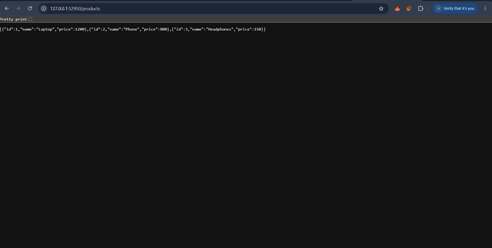
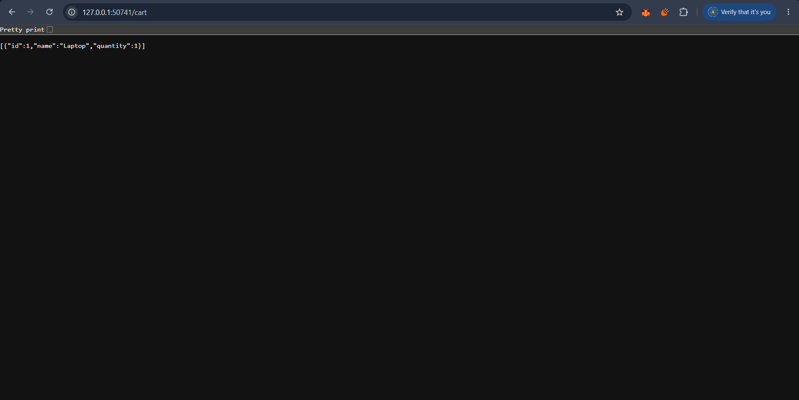
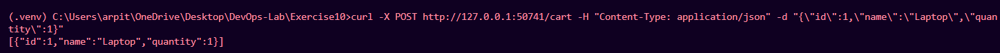
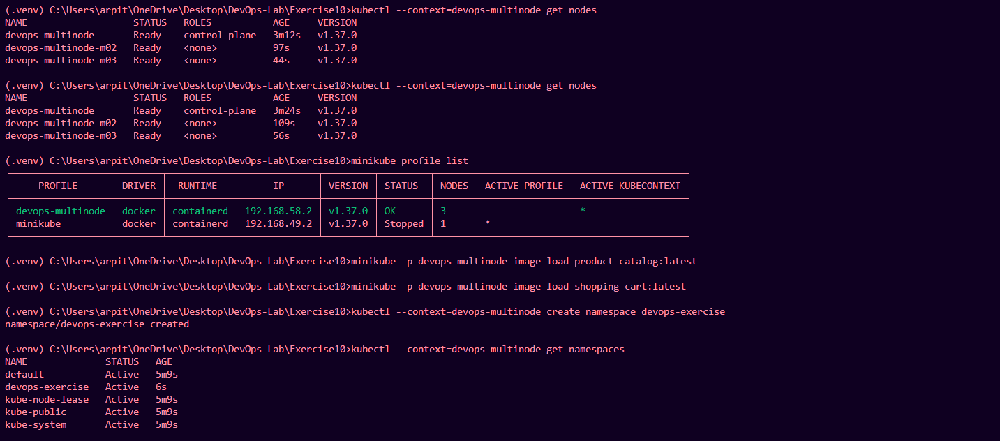
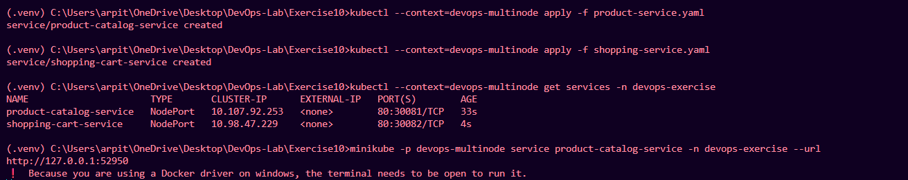

# Exercise 10: Multi-Node Kubernetes Deployment Using Minikube

## Objective

Deploy two Flask microservices — Product Catalog and Shopping Cart — on a three-node Kubernetes cluster using Docker and Minikube.

## Technologies Used

- Python and Flask
- Docker
- Minikube
- Kubernetes
- YAML
- Git and GitHub

## Kubernetes Architecture

The cluster contains:
- One control-plane node
- Two worker nodes
- Namespace: `devops-exercise`
- Product Catalog: two replicas
- Shopping Cart: two replicas

Both applications run in separate Kubernetes Deployments and are exposed through NodePort Services.

## Applications

### 1. Product Catalog

The Product Catalog API returns a JSON list of products.

**Endpoint:** `/products`

The response contains Laptop, Phone, and Headphones, with their IDs and prices.

- Deployment: `product-catalog`
- Replicas: 2
- Service: `product-catalog-service`
- NodePort: `30081`

### 2. Shopping Cart

The Shopping Cart API supports retrieving cart contents and adding items.

**Endpoints:**
- `GET /cart` — Retrieves cart contents.
- `POST /cart` — Adds an item supplied as a JSON object.

Example POST request:

```bash
curl -X POST http://127.0.0.1:PORT/cart \
  -H "Content-Type: application/json" \
  -d "{\"id\":1,\"name\":\"Laptop\",\"quantity\":1}"
```

Replace `PORT` with the port printed by the active Minikube service tunnel.

The successful POST test returned the added Laptop item in JSON format.

- Deployment: `shopping-cart`
- Replicas: 2
- Service: `shopping-cart-service`
- NodePort: `30082`

**Note:** The cart uses in-memory storage, so its contents are not persistent across pod restarts.

## Project Files

| File | Description |
|---|---|
| `product_catalog.py` | Product Catalog Flask application |
| `shopping_cart.py` | Shopping Cart Flask application |
| `Dockerfile.product` | Product Catalog Docker image definition |
| `Dockerfile.shopping` | Shopping Cart Docker image definition |
| `product-deployment.yaml` | Product Catalog Deployment |
| `shopping-deployment.yaml` | Shopping Cart Deployment |
| `product-service.yaml` | Product Catalog Service |
| `shopping-service.yaml` | Shopping Cart Service |

## Deployment and Verification

Start the three-node cluster:

```bash
minikube start --nodes 3 -p devops-multinode --driver=docker
```

Load the existing Docker images:

```bash
minikube -p devops-multinode image load product-catalog:latest
minikube -p devops-multinode image load shopping-cart:latest
```

Create the namespace:

```bash
kubectl --context=devops-multinode create namespace devops-exercise
```

Deploy the applications:

```bash
kubectl --context=devops-multinode apply -f product-deployment.yaml
kubectl --context=devops-multinode apply -f shopping-deployment.yaml
```

Create the Services:

```bash
kubectl --context=devops-multinode apply -f product-service.yaml
kubectl --context=devops-multinode apply -f shopping-service.yaml
```

Verify the nodes, application resources, and Services:

```bash
kubectl --context=devops-multinode get nodes
kubectl --context=devops-multinode get all -n devops-exercise
kubectl --context=devops-multinode get services -n devops-exercise
```

## Screenshots

### 1. Product Catalog API



### 2. Shopping Cart API



### 3. Adding an Item to the Cart



### 4. Three-Node Minikube Cluster



### 5. Kubernetes Services



## Results

- All three Minikube nodes reached the `Ready` state.
- The Product Catalog Deployment reached 2/2 available replicas.
- The Shopping Cart Deployment reached 2/2 available replicas.
- All four application pods were running.
- The Product Catalog API returned the expected product list.
- The Shopping Cart API successfully returned cart contents and accepted a POST request.
- Both NodePort Services were created and tested.

## Conclusion

The exercise demonstrates how to containerize Flask applications and deploy them on a multi-node Kubernetes cluster. Kubernetes Deployments manage application replicas, while NodePort Services provide access to the microservices for testing.
