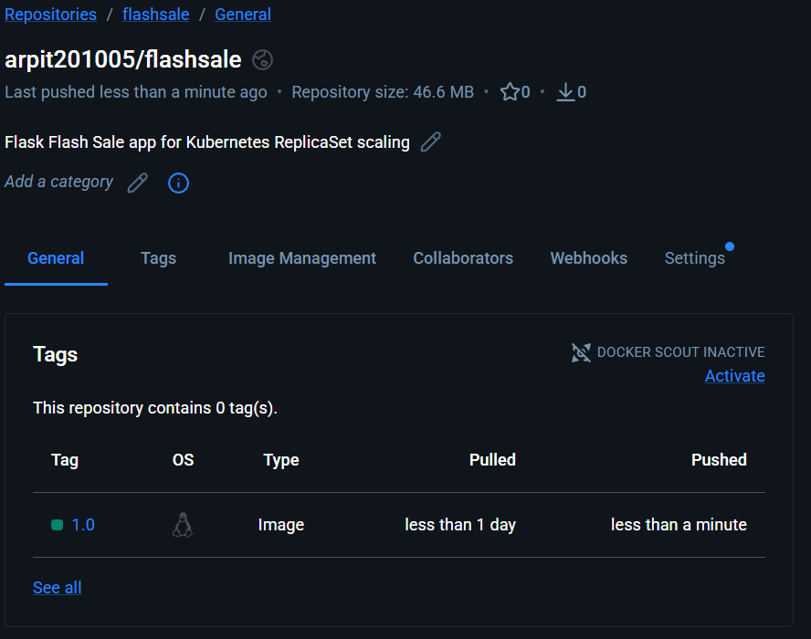

# Exercise 3

## Steps of Execution

Write the `app.py` file and a `Dockerfile` to build the Docker image of the Flask application.

### Command used to build the Docker image:

```bash
docker build -t flashsale:1.0 .
```

Once the image is built, load it into Minikube.

### Command to load the Docker image into Minikube:

```bash
minikube image load flashsale:1.0
```

### Command to create a Minikube server:

```bash
minikube start --driver=docker
```

Once the Minikube server is running, write the `replicaset.yaml` file containing the ReplicaSet and Service configurations.

### Command to apply the configurations in the `replicaset.yaml` file:

```bash
kubectl apply -f replicaset.yaml
```

#### Output:

```text
replicaset.apps/flashsale-rs created
service/flashsale-svc created
```

### Verify the containers using the following command:

```bash
kubectl get pods
```

#### Output:

Initially, three Pods were created by the ReplicaSet.

```text
NAME                 READY   STATUS    RESTARTS   AGE
flashsale-rs-69dm6   1/1     Running   0          ...
flashsale-rs-8nz4d   1/1     Running   0          ...
flashsale-rs-b5w94   1/1     Running   0          ...
```

### Run the following command to scale the replicas from 3 to 5:

```bash
kubectl scale rs flashsale-rs --replicas=5
```

#### Output:

```text
replicaset.apps/flashsale-rs scaled
```

### Verify the scaling using the following command:

```bash
kubectl get rs
```

#### Output:

```text
NAME           DESIRED   CURRENT   READY   AGE
flashsale-rs   5         5         5       ...
```

### Verify the updated Pods using the following command:

```bash
kubectl get pods
```

#### Output:

Five Pods were running successfully after scaling the ReplicaSet to five replicas.

```text
NAME                 READY   STATUS    RESTARTS   AGE
flashsale-rs-69dm6   1/1     Running   0          ...
flashsale-rs-6hrn2   1/1     Running   0          ...
flashsale-rs-8nz4d   1/1     Running   0          ...
flashsale-rs-b5w94   1/1     Running   0          ...
flashsale-rs-zxn4j   1/1     Running   0          ...
```

### Delete one of the Pods using the following command:

```bash
kubectl delete pod flashsale-rs-69dm6
```

#### Output:

```text
pod "flashsale-rs-69dm6" deleted from default namespace
```

### Verify the Pods using the following command:

```bash
kubectl get pods
```

#### Observation:

The ReplicaSet automatically created a replacement Pod after one Pod was deleted. The total number of Pods returned to five.

```text
NAME                 READY   STATUS    RESTARTS   AGE
flashsale-rs-6hrn2   1/1     Running   0          ...
flashsale-rs-8nz4d   1/1     Running   0          ...
flashsale-rs-b5w94   1/1     Running   0          ...
flashsale-rs-nnztm   1/1     Running   0          ...
flashsale-rs-zxn4j   1/1     Running   0          ...
```

### View the Pod distribution across nodes using the following command:

```bash
kubectl get pods -o wide
```

#### Observation:

All five Pods were running on the single Minikube node. The command displays the Pod IP addresses and the node on which each Pod is running.

```text
NAME                 READY   STATUS    RESTARTS   AGE   IP           NODE
flashsale-rs-6hrn2   1/1     Running   0          ...   10.244.0.7   minikube
flashsale-rs-8nz4d   1/1     Running   0          ...   10.244.0.4   minikube
flashsale-rs-b5w94   1/1     Running   0          ...   10.244.0.5   minikube
flashsale-rs-nnztm   1/1     Running   0          ...   10.244.0.8   minikube
flashsale-rs-zxn4j   1/1     Running   0          ...   10.244.0.6   minikube
```

### Access the Flask application

Use the following command to access the application through the Kubernetes Service:

```bash
minikube service flashsale-svc --url
```

Open the URL returned by Minikube in a browser.

The application provides the following endpoints:

- `/` – Displays a welcome message and the serving Pod name.
- `/buy` – Simulates a flash-sale purchase.
- `/health` – Returns the health status of the application.

## Screenshot of the Docker Hub Repository

The Docker image was built and loaded locally into Minikube. If Docker Hub publishing is required, create a repository named `flashsale` and upload the image using the following commands.

### Command to log in to Docker Hub:

```bash
docker login
```

### Command to tag the Docker image:

```bash
docker tag flashsale:1.0 <YOUR_DOCKERHUB_USERNAME>/flashsale:1.0
```

### Command to push the image to Docker Hub:

```bash
docker push <YOUR_DOCKERHUB_USERNAME>/flashsale:1.0
```

Replace `<YOUR_DOCKERHUB_USERNAME>` with your Docker Hub username.

After uploading the image, take a screenshot of your own Docker Hub repository and save it as `screenshots/dockerhub-repository.png`.



## Key Learnings

1. A ReplicaSet maintains the desired number of Pods.
2. Scaling from three to five replicas creates two additional Pods.
3. Kubernetes automatically replaces a deleted Pod.
4. `kubectl get pods -o wide` displays Pod IP addresses and node assignments.
5. A Kubernetes Service provides an endpoint to access the application.
6. Multiple Pods can run on a single Kubernetes node.

## Conclusion

The Flask Flash Sale application was containerized using Docker and deployed on Minikube using a Kubernetes ReplicaSet. The application was successfully scaled from three to five Pods. Automatic Pod replacement was verified, demonstrating Kubernetes self-healing and replica management on a single-node cluster.
