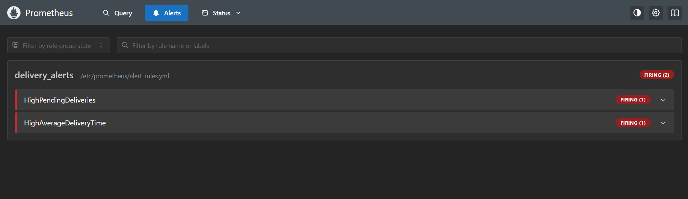
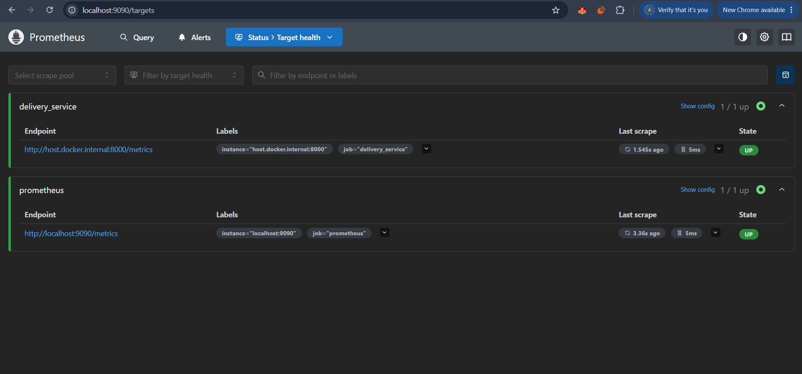
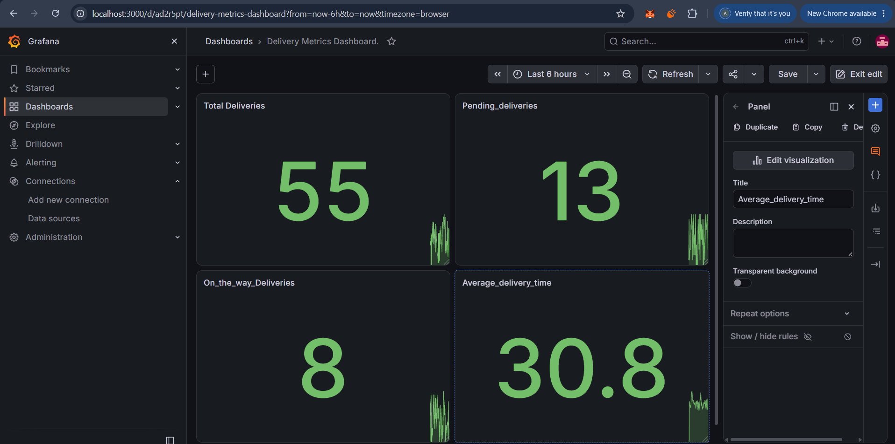

# Exercise 6: Delivery Monitoring and Alerting using Jenkins, Docker, Prometheus and Grafana

## 1. Objective

To develop and deploy a delivery monitoring application using Docker and Jenkins, monitor delivery metrics using Prometheus, visualize the metrics using Grafana, and configure alerts for high pending deliveries and high average delivery time.

## 2. Technologies Used

- **Python** – Generates simulated delivery data and exposes metrics.
- **Docker** – Containerizes the delivery monitoring application.
- **Jenkins** – Automates project validation, Docker image building, and application deployment.
- **Prometheus** – Collects and evaluates delivery metrics.
- **Grafana** – Visualizes delivery metrics through a dashboard.

## 3. Project Structure

```text
Exercise6/
├── Dockerfile.jenkins
├── README.md
├── screenshots/
│   ├── prometheus-alerts.png
│   ├── prometheus-targets.png
│   └── grafana-dashboard.png
└── delivery_monitoring/
    ├── Dockerfile
    ├── Jenkinsfile
    ├── delivery_metrics.py
    ├── requirements.txt
    ├── prometheus.yml
    └── alert_rules.yml
```

## 4. Implementation

### Step 1: Develop the Delivery Monitoring Application

The Python application simulates delivery activity and generates the following metrics:

- `total_deliveries` – Total number of deliveries.
- `pending_deliveries` – Number of pending deliveries.
- `on_the_way_deliveries` – Number of deliveries currently on the way.
- `average_delivery_time` – Delivery time observations used to calculate the average delivery time.

The application exposes the metrics on port **8000** in Prometheus-compatible format.

### Step 2: Containerize the Application Using Docker

A Dockerfile was created to package the Python application and its dependencies into a Docker image.

The application image is built using:

```bash
docker build -t delivery_metrics:latest delivery_monitoring
```

The container exposes port 8000 for metrics collection.

### Step 3: Configure Jenkins Pipeline

A Jenkins pipeline was configured to automate the following stages:

1. **Check Docker** – Verifies Docker availability.
2. **Check Project Files** – Checks whether the required project files exist.
3. **Validate Python Syntax** – Checks the Python source code for syntax errors.
4. **Build Application Image** – Builds the Docker image.
5. **Deploy Delivery Application** – Starts the delivery application container if it is not already running.
6. **Verify Deployment** – Verifies the application container and Docker image.

The pipeline also reports whether the execution succeeds or fails.

### Step 4: Configure Prometheus

Prometheus was configured to scrape metrics from the delivery application using the target:

```text
host.docker.internal:8000
```

The scrape interval is configured to **5 seconds**.

Prometheus also loads the alert rules defined in `alert_rules.yml`.

Prometheus target health can be checked at:

http://localhost:9090/targets

### Step 5: Configure Alert Rules

Two alert rules were configured.

**1. HighPendingDeliveries**

- Condition: `pending_deliveries > 10`
- Duration: 15 seconds
- Severity: Warning

The alert fires when pending deliveries remain above 10 for at least 15 seconds.

**2. HighAverageDeliveryTime**

- Condition: `(average_delivery_time_sum / average_delivery_time_count) > 30`
- Duration: 15 seconds
- Severity: Critical

The alert fires when the average delivery time remains above 30 seconds for at least 15 seconds.

The alert status can be checked at:

http://localhost:9090/alerts

### Step 6: Visualize Metrics Using Grafana

A Grafana dashboard was configured with four panels:

1. Total Deliveries
2. Pending Deliveries
3. On-the-way Deliveries
4. Average Delivery Time

Grafana uses Prometheus as its data source.

The dashboard is available at:

http://localhost:3000

## 5. Results

The following results were verified during execution:

- The delivery application exposed metrics successfully.
- Prometheus successfully scraped the delivery service; the target status was **UP**.
- The Grafana dashboard displayed all four delivery metrics.
- Both `HighPendingDeliveries` and `HighAverageDeliveryTime` reached the **FIRING** state.
- The Jenkins pipeline was configured to validate the project, build the application image, deploy the application, and verify the deployment.

## 6. Screenshots

Add the following screenshots to the `screenshots/` folder:

1. **Prometheus Alerts** – Shows both alert rules in the FIRING state.
2. **Prometheus Targets** – Shows the delivery service target in the UP state.
3. **Grafana Dashboard** – Shows the four delivery metric panels.

Embed them in this README using:

### Prometheus Alerts



### Prometheus Target Health



### Grafana Delivery Metrics Dashboard



## 7. Conclusion

This exercise demonstrates an end-to-end monitoring and alerting workflow using Python, Docker, Jenkins, Prometheus, and Grafana. The delivery application generates metrics, Prometheus collects the metrics and evaluates alert conditions, and Grafana visualizes delivery performance. Jenkins automates key validation, build, and deployment steps, helping make the workflow repeatable.

The implementation demonstrates containerization, CI/CD pipeline automation, metrics monitoring, dashboard visualization, and threshold-based alerting.
