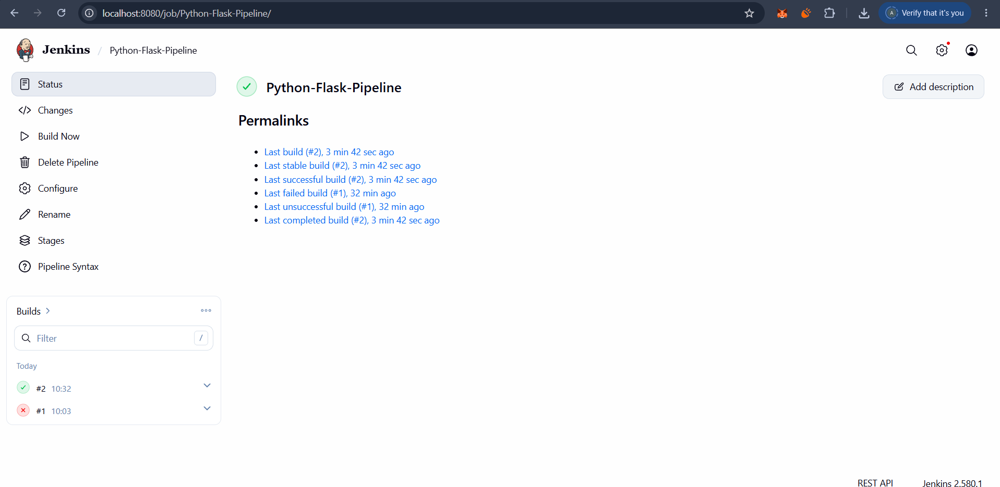

# Exercise 9: Jenkins Multi-Stage Pipeline for Python Flask Application

## Aim
To implement a Jenkins declarative pipeline that automates the build, testing, deployment, execution, and verification of a Python Flask application using Jenkins and GitHub.

## Objectives
- Create a simple Python Flask web application.
- Write unit tests to verify the application's functionality.
- Automate dependency installation and testing using Jenkins.
- Deploy the application files to a deployment directory.
- Run the Flask application and verify its HTTP response.
- Integrate Jenkins with GitHub using Pipeline Script from SCM.

## Project Structure

```text
Exercise9/
├── app.py
├── requirements.txt
├── test_app.py
├── Jenkinsfile
├── .gitignore
└── Screenshots/
    ├── jenkins-dashboard.png
    ├── pipeline-console-output.png
    └── github-files.png
```

## Technologies Used
- Python 3.13.5
- Flask
- Jenkins
- Git and GitHub
- Python unittest framework

## Application Description

The Flask application defined in `app.py` exposes a home route (`/`) that returns the following message:

```text
Hello, Jenkins Multi-Stage Pipeline!
```

The application runs on port `5000`.

## Pipeline Stages

The declarative pipeline is defined in `Jenkinsfile` and consists of five stages.

### 1. Build
- Checks the installed Python version.
- Creates a Python virtual environment.
- Installs the dependencies listed in `requirements.txt`.

### 2. Test
- Executes the unit tests using Python's `unittest` framework.
- Verifies that the home route returns HTTP status code `200` and the expected response message.

### 3. Deploy
- Creates the `python-app-deploy` directory in the Jenkins workspace.
- Copies `app.py` and `requirements.txt` into the deployment directory.

### 4. Run Application
- Starts the Flask application as a background process.
- Stores the process ID and application logs.
- Checks whether the application process starts successfully.

### 5. Test Application
- Sends an HTTP request to `http://127.0.0.1:5000/`.
- Verifies the HTTP status code and response message.
- Marks the pipeline as successful when the verification passes.

## Jenkins Configuration

1. Open the Jenkins dashboard.
2. Create a new job named `Python-Flask-Pipeline`.
3. Select the **Pipeline** job type.
4. Under the Pipeline section, select **Pipeline script from SCM**.
5. Select **Git** as the SCM.
6. Configure the repository details:

   - **Repository URL:** `https://github.com/Arpit201005/DevOps-Lab.git`
   - **Branch:** `*/main`
   - **Script Path:** `Exercise9/Jenkinsfile`

7. Save the configuration.
8. Click **Build Now** to execute the pipeline.
9. Open the build's **Console Output** to inspect the execution results.

## Execution and Testing

The pipeline was executed successfully in Jenkins.

- Python dependencies were installed successfully.
- Unit testing completed successfully, with **1 test passed**.
- Application files were copied to the deployment directory.
- The Flask application started successfully.
- The HTTP response was verified against the expected message.

**Final Build Status: SUCCESS**

```text
Hello, Jenkins Multi-Stage Pipeline!
Pipeline completed successfully!
Finished: SUCCESS
```

## Screenshots

### 1. Jenkins Dashboard


### 2. Pipeline Console Output


> Replace the screenshot filenames above with your actual image filenames if they differ.

## Result

Successfully implemented and executed a Jenkins declarative multi-stage pipeline for a Python Flask application. The pipeline automated dependency installation, unit testing, deployment file preparation, application execution, and HTTP response verification. All five stages completed successfully.
